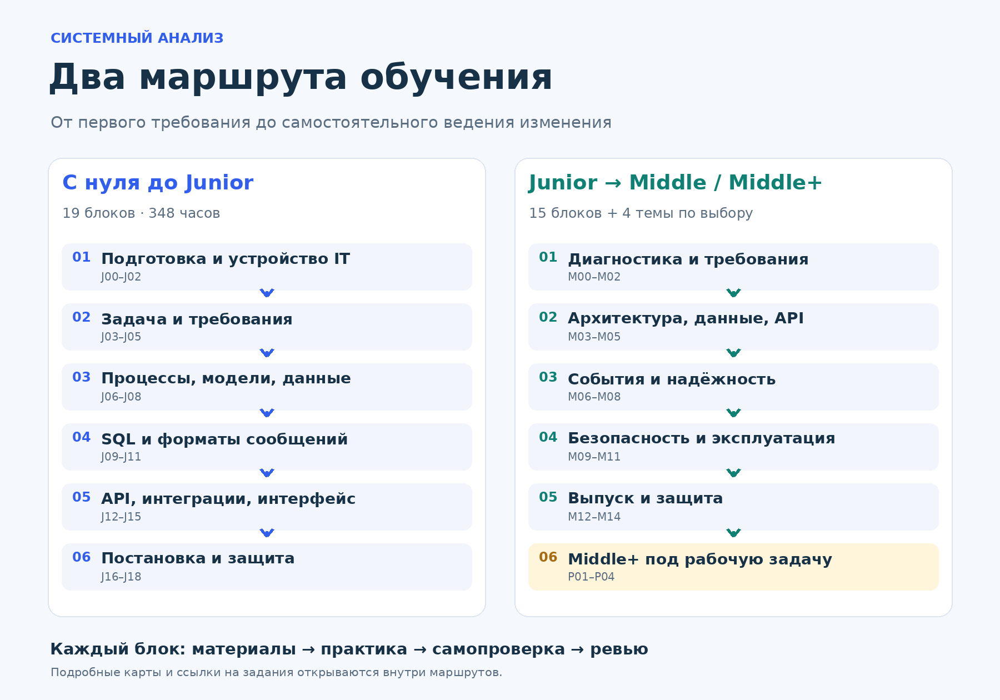

# Системный анализ

Два учебных маршрута: **с нуля до Junior** и **от Junior до Middle**, с дополнительными блоками **Middle Plus**.

Учимся на одном проекте — сервисе записи на занятия. В каждом блоке есть объяснение, материалы, практика, вопросы для самопроверки и критерии сдачи. Последовательность ведёт от задачи заказчика до требований, данных, API и защиты решения.

[Все блоки](CONTENTS.md) · [Библиотека материалов](resources/README.md) · [Учебный проект](projects/README.md) · [Шаблоны](templates/README.md)

## Выбери маршрут

| Маршрут | Кому подходит | Объём | Начало |
|---|---|---|---|
| **[С нуля до Junior](roadmaps/zero-to-junior/README.md)** | Первые шаги в IT или переход из другой профессии | 19 блоков, 348 часов без резерва | [J00 Подготовка](roadmaps/zero-to-junior/modules/j00-setup.md) |
| **[От Junior до Middle](roadmaps/junior-to-middle/README.md)** | Базовые требования, SQL, JSON и API уже знакомы | 15 блоков, 314 часов без резерва | [M00 Диагностика](roadmaps/junior-to-middle/modules/m00-diagnostics.md) |
| **[Middle Plus](roadmaps/middle-plus/README.md)** | Нужна глубина под конкретную рабочую задачу | 4 блока по выбору, 12–20 часов каждый | [Выбрать тему](roadmaps/middle-plus/README.md) |

Часы — ориентир учебной нагрузки, а не обещание срока трудоустройства. Резерв на доработки и примерный темп указаны внутри маршрутов. Если уже знаешь тему, подтверди навык практикой и защитой.

## Как заниматься

1. Открой выбранный маршрут и прочитай условие учебного проекта.
2. Начни с первого блока. Обязательные материалы читай в указанном порядке; дополнительные — по необходимости.
3. Выполни работу, ответь на вопросы и отправь результат на ревью.
4. Исправь замечания, отметь блок в [журнале прогресса](templates/progress.md) и переходи дальше.

## Что будет в портфолио

Требования и сценарии, BPMN и UML, ER-модель, SQL, контракты OpenAPI, интеграционный маппинг, постановки и приёмочные проверки. На втором маршруте — решения по конкуренции, событиям, надёжности, миграциям, наблюдаемости и выпуску.

## Всё под рукой

- [Подробная карта Junior](assets/zero-to-junior-map.png) и [карта Middle / Middle Plus](assets/junior-to-middle-map.png).
- [93 источника с языком и статусом проверки](resources/README.md), включая видео и страницы записей.
- [Практические файлы](practice/README.md): SQL, OpenAPI и PlantUML.
- [Шаблон постановки](templates/spec-template.md) и [журнал прогресса](templates/progress.md).
- [PDF первого маршрута](downloads/01-zero-to-junior.pdf) и [PDF второго маршрута](downloads/02-junior-to-middle-plus.pdf).
- [Материалы для ментора](mentors/README.md).

## Для автора программы

Материалы отображаются средствами Markdown. Сборка сайта не требуется. Чтобы добавить статью или поменять задание, редактируй соответствующую страницу блока.

[Как загрузить и обновлять репозиторий](PUBLISH.md) · [Исходники карт](assets/source/README.md)

Версия 1.1 · 16 октября 2026 года
