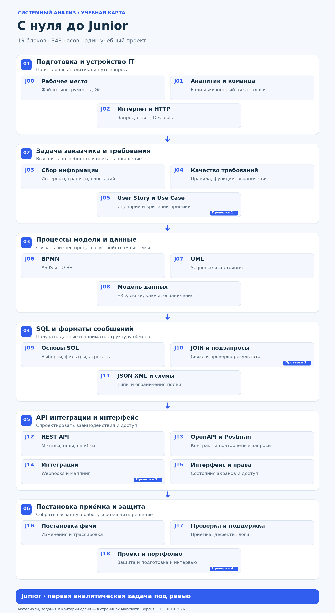

# Системный анализ с нуля до Junior

[Главная](../../README.md) · [Все блоки](../../CONTENTS.md) · [Источники](../../resources/README.md)

Учебный маршрут с практикой и материалами

Версия 1.0 · 16 октября 2026 года

Этот гид рассчитан на человека, который ещё не работал системным аналитиком. Здесь можно начать без программирования и двигаться по одному проекту: сначала разобраться в задаче заказчика, затем описать поведение системы, данные, интерфейсы и проверки. На выходе у тебя будет комплект связанных работ, который можно показать ментору и использовать в портфолио.

Цель маршрута — подготовить тебя к ограниченной аналитической задаче под ревью более опытного коллеги. Например, описать запись на занятие, добавить фильтр в список или согласовать поля нового метода API. Название Junior в разных компаниях означает разное; здесь уровень определяется тем, какую работу ты можешь сделать и объяснить.

**[Начать с J00](modules/j00-setup.md)** · [Справочник и шаблоны](appendices.md) · [PDF для чтения](../../downloads/01-zero-to-junior.pdf)

## Карта маршрута

Открой изображение отдельно, чтобы увеличить. Читай карточки слева направо, затем переходи на следующую строку. Полные задания открываются по ссылкам в таблице ниже.

## Как проходить маршрут

Внутри каждого блока есть обязательное чтение, дополнительные материалы, задание и самопроверка. Начни с обязательных источников в указанном порядке. Дополнительные открывай, если основной материал не помог или хочется разобраться глубже. Не нужно прочитать весь интернет перед первой практикой.

Рабочий цикл такой: прочитай небольшую часть, попробуй применить её в проекте, выпиши вопросы, закончи работу, объясни решение вслух и отправь на проверку. После замечаний обнови ту же работу. Отмечай не «посмотрел видео», а «могу сделать без подсказки».

Для английских источников разрешён перевод страницы. Сохраняй английские названия полей и терминов: они встретятся в документации и на работе. Первое чтение стандарта не должно превращаться в попытку выучить его целиком: в заданиях указан нужный фрагмент.

**Оценки времени — наш ориентир на учебную работу, а не статистика курсов.** В сумме блоки занимают около 350 часов; с повторением и доработками разумно планировать 400–460 часов. При 12 часах в неделю это примерно 8–9 месяцев до завершения учебной части. При 20 часах — около 5–6 месяцев. Поиск работы и паузы считаются отдельно. После первых двух недель пересчитай план по своему темпу.

### Навигация по блокам

| Шаг | Что изучаем | Ориентир | Что сдаём |
|---|---|---|---|
| [J00](modules/j00-setup.md) | Подготовка рабочего места | 6 ч | Папка проекта и журнал обучения |
| [J01](modules/j01-analyst-role.md) | Профессия и разработка ПО | 10 ч | Карта ролей и путь задачи |
| [J02](modules/j02-internet-http.md) | Интернет и HTTP | 14 ч | Разбор настоящего запроса |
| [J03](modules/j03-discovery.md) | Задача заказчика и границы | 16 ч | Vision, вопросы и глоссарий |
| [J04](modules/j04-requirements.md) | Требования и их качество | 20 ч | Каталог требований |
| [J05](modules/j05-user-stories-use-cases.md) | User Story и Use Case | 18 ч | Истории, сценарии и приёмка |
| [J06](modules/j06-bpmn.md) | Процессы в BPMN | 18 ч | AS IS и TO BE |
| [J07](modules/j07-uml.md) | UML и жизненный цикл | 18 ч | Sequence и таблица переходов |
| [J08](modules/j08-data-modeling.md) | Данные и ER модель | 22 ч | ERD и словарь данных |
| [J09](modules/j09-sql-basics.md) | SQL с одной таблицей | 24 ч | Запросы и ожидаемые результаты |
| [J10](modules/j10-sql-joins.md) | SQL с несколькими таблицами | 24 ч | Отчёты и диагностика данных |
| [J11](modules/j11-data-formats.md) | JSON, XML и схемы | 14 ч | Примеры сообщений и ограничения |
| [J12](modules/j12-rest-api.md) | Проектирование REST API | 24 ч | Контракт методов |
| [J13](modules/j13-openapi-postman.md) | OpenAPI и Postman | 24 ч | Спецификация и коллекция |
| [J14](modules/j14-integrations.md) | Интеграции и webhooks | 18 ч | Интеграционная спецификация |
| [J15](modules/j15-ui-access.md) | Интерфейс и права доступа | 16 ч | Состояния экранов и матрица прав |
| [J16](modules/j16-specification-changes.md) | Постановка и изменения | 18 ч | Полная постановка одной фичи |
| [J17](modules/j17-testing-support.md) | Проверка и сопровождение | 16 ч | Приёмка, дефекты и разбор логов |
| [J18](modules/j18-project-defense.md) | Защита и выход на рынок | 28 ч | Защищённый проект и портфолио |

J09 и J10 можно тренировать понемногу параллельно с последующими блоками. J12 начинай после J02, J05, J08 и J11. Для J14 сначала закончи J07 и J12. Не пропускай требования ради SQL и API: без них техническое решение легко отвечает не на тот вопрос.

### Как понять что блок пройден

Для каждой работы ментор ставит оценку от 0 до 3 по пяти признакам: верность бизнес-смыслу, полнота сценариев, техническая согласованность, возможность проверки, ясность объяснения. 0 — работа отсутствует или смысл нарушен; 1 — сделано с существенной помощью; 2 — решение самостоятельное, нужны локальные правки; 3 — решение устойчиво к новым условиям и аргументировано.

Для перехода дальше нужны минимум 2 по каждому признаку и исправленные критичные замечания. Критичное замечание — например, возможность получить чужую запись, потеря подтверждённого бронирования, противоречие между статусами в API и базе. Красивое оформление не компенсирует такую ошибку. При самостоятельном прохождении попроси практикующего аналитика проверить хотя бы контрольные точки после J05, J10, J14 и J18.

## Учебный проект

[Условие и правила первой версии](../../projects/README.md#project-junior). Практика каждого блока продолжает этот проект.

## Рабочие материалы

- [Стартовая SQL-база](../../practice/starter.sql)
- [Пример OpenAPI](../../practice/openapi-example.yaml)
- [Пример sequence в PlantUML](../../practice/sequence-example.puml)
- [Шаблон постановки](../../templates/spec-template.md)
- [Журнал прогресса](../../templates/progress.md)
- [Источники именно этого маршрута](../../resources/zero-to-junior.md)
- [Приложения и ответы для самопроверки](appendices.md)

## После завершения

Защити проект и исправь критичные замечания. Затем переходи [от Junior до Middle](../junior-to-middle/README.md).
